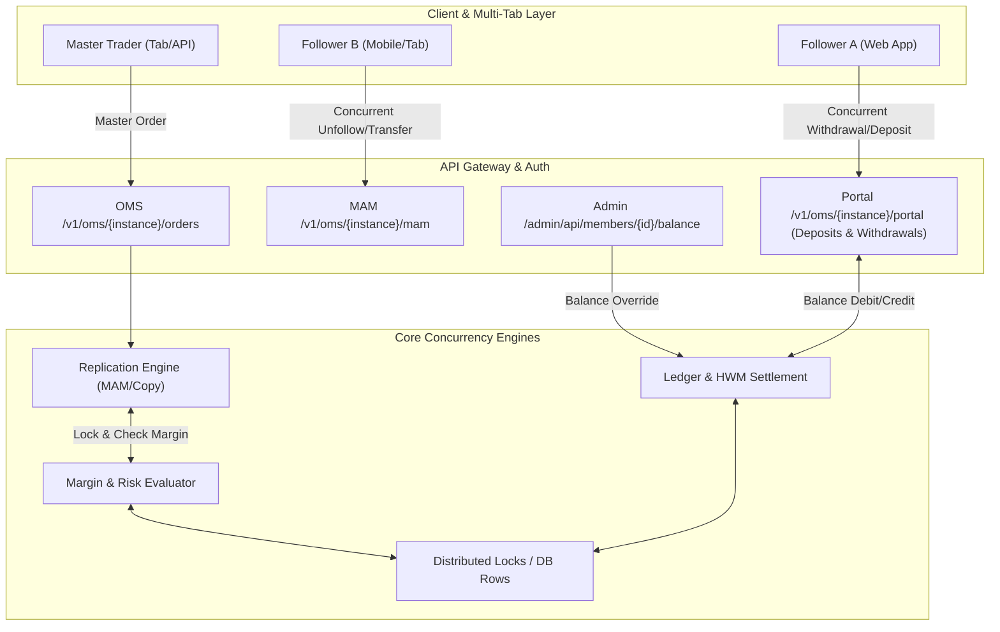

# MAM, Copy Trading & Balance Concurrency / Race Condition Test Plan

## 1. Executive Summary & Objective

The objective of this test plan is to rigorously identify and validate **concurrency defects, state desynchronization, financial double-spending, and margin violations** occurring at the intersection of:
1. **Multi-Account Manager (MAM) & Copy Trading engines** (Master/Follower order replication, lot allocation algorithms, trade mirroring).
2. **Real-time Balance Operations** (Deposits, Withdrawals, Wallet-to-Trading-Account Transfers, and Admin Adjustments).
3. **Risk & Margin Engines** (Free margin locks, stop-out liquidation levels, and performance fee/High-Water Mark calculations).

In financial platforms, race conditions between **balance state changes** and **trade order lifecycle events** are the single most dangerous class of vulnerabilities, often resulting in **uncollateralized margin exposure, duplicate cash withdrawals, negative account balances, or corrupted profit-sharing ledgers**.

---

## 2. Platform Architecture & Affected Systems



---

## 3. High-Priority Race Condition Test Scenarios

### Category 1: Withdrawal & Transfer Out vs Active Trade Replication (Capital Depletion)

| Test ID | Scenario | Simultaneous Actions (Concurrent / Exact Millisecond) | Expected Safe Behavior | Bug / Vulnerability to Expose | Priority |
| :--- | :--- | :--- | :--- | :--- | :--- |
| **RACE-W01** | Full Withdrawal vs Master Order Replication | Follower requests 100% free margin withdrawal while Master submits large BUY order. | Either order is rejected (insufficient margin) OR withdrawal is rejected/reduced to remaining free margin. | **Negative Free Margin**: Both succeed. Account opens trade with \$0 unencumbered balance. | **P0 (Critical)** |
| **RACE-W02** | Double-Withdrawal Race (Double Spend) | Follower fires 2 simultaneous withdrawal requests, each for 80% of account balance. | Only 1st request succeeds; 2nd request is rejected (`400 Insufficient Funds`). | **Double Withdrawal**: Both succeed, draining 160% of account equity into external addresses. | **P0 (Critical)** |
| **RACE-W03** | Internal Wallet Transfer-Out vs Order Sizing | Follower transfers funds from trading account to portal wallet (`/wallets/transfer`) while Master trade is replicating. | Atomic balance check locks funds during replication sizing; transfer fails if free margin < requested amount. | **Over-leverage**: Replicator sizes trade on pre-transfer balance, but wallet extracts funds before margin is deducted. | **P0 (Critical)** |
| **RACE-W04** | Withdrawal During Adverse Floating Drawdown | Follower submits withdrawal on slow internet while Master trade moves rapidly into floating loss. | Withdrawal amount re-evaluated against real-time equity at execution time. | **Deficit Withdrawal**: Withdrawal processes based on stale equity, resulting in negative final account balance. | **P1 (High)** |
| **RACE-W05** | Master Withdrawal vs Follower Pro-Rata Sizing | Master withdraws 70% of their capital while placing a new market order in Equity-Ratio mode. | Master order sizing and follower allocation use identical snapshot of master equity. | **Allocation Skew**: Follower copies massive lot because master balance was read pre-withdrawal, creating catastrophic follower exposure. | **P0 (Critical)** |

---

### Category 2: Deposit & Transfer In vs Sizing, Margin & High-Water Mark

| Test ID | Scenario | Simultaneous Actions (Concurrent / Exact Millisecond) | Expected Safe Behavior | Bug / Vulnerability to Expose | Priority |
| :--- | :--- | :--- | :--- | :--- | :--- |
| **RACE-D01** | Deposit Arrival Mid-Replication (Multiplier vs Ratio) | Follower deposits \$10,000 at the exact moment Master order is fanning out to followers. | Trade either executes strictly with old balance OR cleanly updates allocation multiplier before execution. | **Partial / Corrupted Allocation**: Race condition between order execution thread and deposit credit thread causes order sizing crash or step-size violation. | **P1 (High)** |
| **RACE-D02** | Deposit vs Performance Fee Deduction (HWM Race) | Follower deposits capital at the exact moment Master squares off a winning trade. | Deposit credited cleanly to capital; HWM increases by deposit amount; fee calculated ONLY on actual trading profit. | **Deposit Taxation Bug**: Deposit is erroneously registered as trading profit and 50% performance fee is deducted from the deposited amount. | **P0 (Critical)** |
| **RACE-D03** | Rapid Multi-Click Deposit Confirmation | Admin/Webhook triggers deposit approval (`/review`) twice simultaneously. | Idempotency lock prevents double processing of deposit ID. | **Duplicate Credit**: Deposit credited twice to the trader's balance. | **P0 (Critical)** |
| **RACE-D04** | Deposit Collision with Margin Call Liquidation | Deposit confirmation arrives at the exact millisecond the risk engine triggers stop-out liquidation (`margin_level < 50%`). | Atomic transaction: either liquidation completes before deposit, or deposit halts liquidation. | **Zombie Liquidation / Double Execution**: Positions liquidated at market AND deposit locked in transit, or equity jumps while positions are half-closed. | **P0 (Critical)** |

---

### Category 3: Unfollow Lifecycle vs Balance Cash Flows

| Test ID | Scenario | Simultaneous Actions (Concurrent / Exact Millisecond) | Expected Safe Behavior | Bug / Vulnerability to Expose | Priority |
| :--- | :--- | :--- | :--- | :--- | :--- |
| **RACE-UB01** | Full Withdrawal + Unfollow Collision | Follower triggers `POST /unfollow` and `POST /portal/withdrawals` concurrently. | Operations are serialized. Positions are closed/detached, final PnL realized, fees settled, and remaining balance withdrawn. | **Balance Inconsistency / Ghost Orders**: Withdrawal drains funds before position squareoff fee/loss is deducted, leaving broker holding bad debt. | **P0 (Critical)** |
| **RACE-UB02** | Deposit During Unfollow Settlement Window | Follower deposits funds while an unfollow action is squaring off open positions. | New deposit is isolated from MAM settlement pool and credited cleanly to member's free balance. | **Trapped Funds / Allocation Desync**: Deposit is absorbed into the unlinking pool or calculated into master's share. | **P1 (High)** |
| **RACE-UB03** | Re-Follow with Immediate Withdrawal | Follower unfollows in Tab 1, withdraws in Tab 2, and immediately follows a new Master in Tab 3. | New follow requires verification of settled, unencumbered balance. | **Ghost Margin Anchor**: New follow locks `starting_balance` based on pre-withdrawal funds. | **P0 (Critical)** |

---

### Category 4: Concurrency in Allocation & Multi-Follower Fleets

| Test ID | Scenario | Simultaneous Actions (Concurrent / Exact Millisecond) | Expected Safe Behavior | Bug / Vulnerability to Expose | Priority |
| :--- | :--- | :--- | :--- | :--- | :--- |
| **RACE-MF01** | 20 Followers Concurrently Deposit/Withdraw during Burst | Master fires 5 orders in 1 second while 20 followers are executing transfers between wallets and accounts. | Every follower transaction is isolated. Margin checks prevent overdraft. No database lock deadlocks. | **DB Deadlock / Thread Starvation**: OMS hangs, orders execute with 10s latency, or followers receive out-of-order partial fills. | **P0 (Critical)** |
| **RACE-MF02** | Follower Balance Drain below Minimum Lot | Follower withdraws balance down to \$10 while Master submits a 1.0 BTC order. | Follower order rejected due to sub-minimum lot size or insufficient margin. | **Sub-Lot Underflow**: Platform generates zero-lot or invalid precision order that breaks the Liquidity Provider connector. | **P1 (High)** |

---

## 4. Execution Methodology & Test Harness Design

### Test Setup Architecture
Tests run programmatically using multi-threaded execution to achieve millisecond-level precision:

```python
import concurrent.futures
import requests

def run_race_test(action_a, action_b):
    with concurrent.futures.ThreadPoolExecutor(max_workers=2) as executor:
        # Submit both requests simultaneously
        future_a = executor.submit(action_a)
        future_b = executor.submit(action_b)
        
        res_a = future_a.result()
        res_b = future_b.result()
    
    return res_a, res_b
```

### Verification Checklist for Each Test
1. **Balance & Equity Invariant**: `Balance + Unrealized PnL == Equity` at all times.
2. **Margin Invariant**: `Free Margin + Used Margin == Equity`. Free margin must NEVER be negative unless stop-out has occurred.
3. **Ledger Integrity**: Sum of all credits and debits must match final balance exactly.
4. **Idempotency**: Identical `client_request_id` or withdrawal reference must never result in duplicate debit/credit.
5. **No Double-Spending**: Total outgoing funds across concurrent requests must not exceed initial balance.
